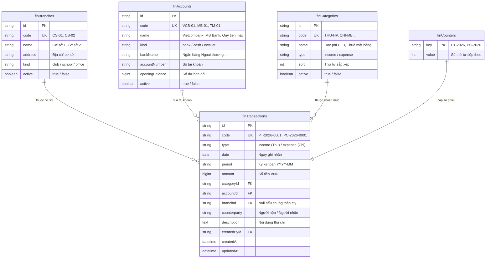

# Kế hoạch triển khai: Phần mềm Quản lý Tài chính — Công ty CP Cờ vua Dương Sinh

- **Ngày cập nhật:** 2026-11-20
- **Ứng dụng:** `nocofin` (NocoBase 3, template `@nocobase/app-template-default`)
- **Đơn vị sử dụng:** Công ty CP Cờ vua Dương Sinh
- **Người vận hành chính giai đoạn 1:** Thầy Tường (Giám đốc)
- **Trạng thái:** Sẵn sàng triển khai Giai đoạn 1 (Sổ thu chi & Quản lý quỹ dòng tiền)

---

## 1. Bối cảnh thực tế & Yêu cầu nghiệp vụ

Sau phiên trao đổi brainstorming trực tiếp với Thầy Tường (Giám đốc), các thông tin thực tế cốt lõi của Dương Sinh được xác định như sau:

1. **Quy mô hoạt động:** Hiện công ty đang vận hành **2 cơ sở đào tạo cờ vua**. Hệ thống cần quản lý độc lập dòng tiền, doanh thu và chi phí theo từng cơ sở (Cost Center) cũng như toàn công ty.
2. **Kênh dòng tiền chủ đạo:** Học phí của học viên và doanh thu bán học cụ (bàn cờ, đồng hồ, sách cờ) **chủ yếu giao dịch qua chuyển khoản ngân hàng**. Tiền mặt tại cơ sở chỉ chiếm tỷ trọng nhỏ. Do đó, hệ thống tập trung tối ưu việc quản lý các Tài khoản Ngân hàng (số dư, biến động, đối chiếu giao dịch).
3. **Đối tượng sử dụng hệ thống:**
   - **Hiện tại:** Chỉ duy nhất **Thầy Tường (Giám đốc)** trực tiếp sử dụng phần mềm trên cả máy tính và điện thoại để theo dõi số dư, ghi nhận nhanh các khoản thu học phí/bán hàng khi có thông báo ngân hàng, quản lý các khoản chi vận hành cơ sở.
   - **Tương lai:** Hệ thống sẵn sàng phân quyền cho Kế toán, Thủ quỹ hoặc Quản lý cơ sở khi công ty tuyển dụng hoặc mở rộng, mà không cần thay đổi kiến trúc cơ sở dữ liệu hay API.
4. **Trọng tâm ưu tiên tuyệt đối (Giai đoạn 1):**
   - **Sổ thu chi & Quản lý quỹ dòng tiền (Cashflow & Bank Book)**: Thay thế sổ tay/Excel, ghi nhận mọi biến động tiền ra/tiền vào tức thời, phân loại cơ sở và khoản mục, báo cáo số dư quỹ thực tế mọi lúc mọi nơi.

---

## 2. Mục tiêu Giai đoạn 1

1. **Ghi nhận thu chi nhanh chóng:** Thao tác tạo phiếu thu (học phí, bán hàng...), phiếu chi (mặt bằng, thù lao HLV, tiền điện nước...) mất không quá 15 giây, thao tác mượt mà trên cả trình duyệt máy tính và điện thoại thông minh.
2. **Quản lý đa quỹ & tài khoản ngân hàng:** Theo dõi chính xác số dư từng tài khoản ngân hàng (Vietcombank, MB, Techcombank...) và quỹ tiền mặt tại 2 cơ sở. Tự động cập nhật số dư khả dụng ngay khi lập hoặc sửa phiếu.
3. **Báo cáo tài chính trực quan cho Giám đốc:**
   - Tổng thu, tổng chi, dòng tiền ròng (thặng dư thu chi) theo tháng/kỳ.
   - So sánh doanh thu và chi phí giữa **2 cơ sở**.
   - Cơ cấu nguồn thu (học phí vs bán hàng vs giải đấu) và cơ cấu chi phí (mặt bằng vs HLV vs vận hành).
4. **Bảo toàn dữ liệu & kiến trúc chuẩn:** Mã phiếu tự động sinh (PT-2026-0001, PC-2026-0001), chống gửi trùng giao dịch (Idempotency), hỗ trợ rút/chuyển dữ liệu và mở rộng sang Giai đoạn 2 (Quản lý Học phí & Công nợ học viên).

*Ngoài phạm vi Giai đoạn 1 (để lại các giai đoạn sau):* Quản lý danh sách từng học viên & điểm danh (Giai đoạn 2), quy trình duyệt chi đa cấp (Giai đoạn 3), tự động đồng bộ API với ngân hàng (Open Banking).

---

## 3. Lộ trình triển khai tổng thể

| Giai đoạn | Tên module / Mục tiêu | Trọng tâm nghiệp vụ | Trạng thái |
| :--- | :--- | :--- | :--- |
| **Giai đoạn 1** | **Sổ thu chi & Quản lý quỹ dòng tiền** | Quản lý 2 cơ sở, tài khoản ngân hàng & tiền mặt, danh mục thu/chi, lập phiếu thu/chi, Dashboard dòng tiền cho Thầy Tường | **Đang thực hiện** |
| **Giai đoạn 2** | **Quản lý Học viên & Công nợ học phí** | Danh sách học viên 2 cơ sở, lớp học, kỳ đóng học phí, phiếu thu gắn học viên, cảnh báo nợ học phí | Dự kiến kế tiếp |
| **Giai đoạn 3** | **Quản lý Tài chính Giải đấu & Sự kiện** | Hạch toán riêng dòng tiền giải đấu (lệ phí, tài trợ, giải thưởng, trọng tài), tính lãi/lỗ từng giải cờ | Dự kiến |
| **Giai đoạn 4** | **Thù lao HLV & Báo cáo nâng cao** | Chấm công/buổi dạy của HLV, tính thù lao tự động, xuất báo cáo P&L theo từng cơ sở ra Excel/PDF | Dự kiến |

---

## 4. Thiết kế chi tiết Giai đoạn 1 — Sổ thu chi & Quản lý quỹ

### 4.1 Vai trò & Phân quyền (RBAC)

Để tối ưu cho thực tế Thầy Tường là người dùng duy nhất hiện tại, cấu hình quyền được thiết kế:

1. **Giám đốc (`finance-director` / Quản trị viên):**
   - Toàn quyền: Xem Dashboard tổng quan; Lập, sửa, xoá phiếu thu/chi; Quản lý tài khoản ngân hàng; Quản lý cơ sở; Quản lý danh mục khoản mục.
2. **Kế toán (`finance-accountant` - Dự phòng tương lai):**
   - Xem báo cáo; lập/sửa/xoá phiếu; xem tài khoản quỹ và cơ sở.
3. **Thủ quỹ / Lễ tân cơ sở (`finance-cashier` - Dự phòng tương lai):**
   - Chỉ xem danh sách và tạo phiếu thu/chi hàng ngày; không được sửa/xoá phiếu cũ nếu không có quyền.

*Cơ chế:* Sử dụng chuẩn NocoBase 3 Authorization (`authorizationToken`), quyền phân định rõ ràng giữa quyền truy cập trang (Page Grant) và quyền gọi API (Action Grant).

### 4.2 Mô hình Dữ liệu (Database Schema)

Dữ liệu lưu trữ dạng số nguyên VND (`bigint`), không lưu số thập phân. Số phiếu sinh tuần tự chống trùng lặp qua bộ đếm.

#### Dữ liệu khởi tạo mặc định (Seed Data phù hợp với Cờ vua Dương Sinh):
* **2 Cơ sở:**
  1. `CS-01`: Cơ sở 1 (Cơ sở chính)
  2. `CS-02`: Cơ sở 2
* **Tài khoản Quỹ (Ưu tiên ngân hàng chuyển khoản):**
  1. `TK-BANK-01`: Tài khoản Ngân hàng chính (tiếp nhận học phí chuyển khoản & thanh toán bán hàng)
  2. `TK-CASH-01`: Quỹ tiền mặt Cơ sở 1
  3. `TK-CASH-02`: Quỹ tiền mặt Cơ sở 2
* **Khoản mục Thu (Income):**
  - Học phí các lớp cờ vua CLB (theo khoá/tháng)
  - Học phí dạy kèm 1-1 / Lớp VIP
  - Hợp tác đào tạo cờ vua tại trường học
  - Bán bàn cờ, quân cờ, đồng hồ thi đấu
  - Bán sách, giáo trình cờ vua độc quyền
  - Lệ phí tham gia giải đấu cờ vua
  - Tài trợ & Doanh thu khác
* **Khoản mục Chi (Expense):**
  - Thù lao & lương HLV cờ vua
  - Chi phí thuê mặt bằng 2 cơ sở
  - Tiền điện, nước, internet các cơ sở
  - Nhập hàng thiết bị cờ (bàn, cờ, đồng hồ)
  - In ấn sách, tài liệu, giáo trình
  - Chi phí tổ chức giải đấu (giải thưởng, cúp, huy chương)
  - Chi phí Marketing, quảng cáo & tuyển sinh
  - Chi phí quản lý & vận hành khác

---

### 4.3 Danh sách API Endpoints (`server/routes/finance/`)

| Method | Endpoint | Quyền thao tác | Mô tả nghiệp vụ |
| :--- | :--- | :--- | :--- |
| `GET` | `/api/finance/reports/overview` | `finance.reports:view` | Tổng hợp KPI: Tổng thu, tổng chi, dòng tiền ròng, số dư từng tài khoản theo kỳ |
| `GET` | `/api/finance/reports/by-branch` | `finance.reports:view` | Báo cáo so sánh doanh thu - chi phí giữa 2 cơ sở |
| `GET` | `/api/finance/reports/by-category` | `finance.reports:view` | Cơ cấu thu chi theo từng khoản mục |
| `GET` | `/api/finance/transactions` | `finance.transactions:view` | Danh sách phiếu thu/chi (phân trang, lọc ngày, lọc cơ sở, lọc tài khoản) |
| `POST` | `/api/finance/transactions` | `finance.transactions:create` | Lập phiếu thu/chi mới (tự sinh mã PT/PC, chống gửi trùng, cập nhật quỹ) |
| `PATCH`| `/api/finance/transactions/:id` | `finance.transactions:update` | Sửa thông tin phiếu (chỉ người có thẩm quyền) |
| `DELETE`| `/api/finance/transactions/:id`| `finance.transactions:delete` | Huỷ phiếu thu/chi |
| `GET` | `/api/finance/accounts` | `finance.accounts:view` | Danh sách tài khoản quỹ & số dư khả dụng tức thời |
| `POST` | `/api/finance/accounts` | `finance.accounts:manage` | Thêm mới tài khoản ngân hàng / ví / quỹ tiền mặt |
| `PATCH`| `/api/finance/accounts/:id` | `finance.accounts:manage` | Sửa thông tin / ngừng sử dụng tài khoản |
| `GET` | `/api/finance/branches` | `finance.branches:view` | Danh sách 2 cơ sở |
| `POST` | `/api/finance/branches` | `finance.branches:manage` | Thêm mới cơ sở |
| `PATCH`| `/api/finance/branches/:id` | `finance.branches:manage` | Đổi tên, địa chỉ, trạng thái cơ sở |
| `GET` | `/api/finance/categories` | `finance.categories:read` | Danh mục khoản mục thu chi |
| `POST` | `/api/finance/categories` | `finance.categories:create` | Thêm mới khoản mục thu/chi |
| `PATCH`| `/api/finance/categories/:id` | `finance.categories:update`| Sửa tên/loại hoặc ngừng dùng khoản mục |

---

### 4.4 Thiết kế Giao diện Người dùng (Client Pages)

Giao diện sử dụng thiết kế chuẩn shadcn/ui + Tailwind CSS, hỗ trợ tiếng Việt 100%, tự động co giãn tối ưu cho màn hình điện thoại di động (Responsive):

1. **Trang Tổng quan Tài chính (`/finance`):**
   - Bộ chọn kỳ làm việc (Tháng này, Tháng trước, Tuỳ chọn khoảng ngày).
   - 4 Thẻ chỉ số chính:
     - 📈 **Tổng Thu** (Hiển thị VND format rõ ràng, so sánh với kỳ trước)
     - 📉 **Tổng Chi**
     - 💰 **Dòng tiền ròng (Chênh lệch Thu - Chi)**
     - 🏦 **Tổng số dư khả dụng (Tổng tiền trong các tài khoản ngân hàng + tiền mặt)**
   - Biểu đồ dòng tiền thu chi theo ngày/tháng.
   - Thẻ theo dõi chi tiết số dư từng tài khoản ngân hàng và từng quỹ tiền mặt.
   - Bảng phân tích so sánh kết quả tài chính giữa **Cơ sở 1** và **Cơ sở 2**.
2. **Sổ Thu Chi (`/finance/transactions`):**
   - Nút hành động nhanh: **+ Lập phiếu thu** (xanh lá), **- Lập phiếu chi** (đỏ cam).
   - Bộ lọc tiện lợi: Lọc theo Cơ sở (Cơ sở 1 / Cơ sở 2 / Toàn bộ), theo Tài khoản quỹ, theo Khoản mục, theo Khoảng ngày.
   - Bảng danh sách phiếu: Mã phiếu, Ngày ghi, Loại (Thu/Chi), Khoản mục, Số tiền, Tài khoản giao dịch, Cơ sở, Người nộp/nhận, Ghi chú.
   - Trên điện thoại: Tự động chuyển đổi bảng thành danh sách Thẻ tóm tắt dễ bấm, xem chi tiết và sửa phiếu bằng hộp thoại vuốt/drawer.
3. **Quản lý Tài khoản Quỹ (`/finance/accounts`):**
   - Danh sách tài khoản ngân hàng (Tên ngân hàng, Số tài khoản, Chủ tài khoản, Số dư ban đầu, Số dư hiện tại).
   - Quỹ tiền mặt tại từng cơ sở.
   - Thao tác thêm/sửa/ngừng sử dụng tài khoản.
4. **Quản lý 2 Cơ sở (`/finance/branches`):**
   - Xem và cập nhật tên, mã, địa chỉ của Cơ sở 1 và Cơ sở 2.
5. **Cài đặt Danh mục Khoản mục (`/settings/finance/categories`):**
   - Nằm trong Cài đặt hệ thống $\rightarrow$ Nghiệp vụ tài chính.
   - Cho phép Thầy Tường chủ động thêm các khoản mục thu hoặc chi mới mà không cần can thiệp code.

---

## 5. Kế hoạch Các bước Thực hiện (Checklist)

- [x] **Bước 1 — Khảo sát & Brainstorming:**
  - Xác định mô hình: 2 cơ sở, giao dịch chuyển khoản chủ đạo, Thầy Tường là người dùng duy nhất giai đoạn đầu.
- [x] **Bước 2 — Cơ sở dữ liệu & Di chuyển (Migration & Seeds):**
  - Hoàn thiện migration 5 bảng dữ liệu tài chính (`finBranches`, `finAccounts`, `finCategories`, `finTransactions`, `finCounters`).
  - Viết seed dữ liệu mẫu chuẩn cho Cờ vua Dương Sinh (2 cơ sở, tài khoản ngân hàng, bộ danh mục khoản mục chi tiết).
  - Viết seed phân quyền độc lập cho Giám đốc (`finance-director`), Kế toán (`finance-accountant`), Thủ quỹ (`finance-cashier`).
  - Viết kiểm thử tự động cho migration (kiểm tra `up` và `down` toàn vẹn: `tests/database/finance-migration.test.ts`).
- [x] **Bước 3 — Backend Service, Provider & Security:**
  - Đăng ký `FinanceProvider` tích hợp Authorization Token.
  - Xây dựng tầng Service xử lý logic: cấp số phiếu tuần tự (PT-2026-0001, PC-2026-0001), cập nhật số dư tài khoản, tổng hợp báo cáo.
  - Xây dựng các route `/api/finance/*` với `describeRoute`, kiểm tra xác thực, phân quyền và chống gửi trùng (`executeIdempotentMutation`).
  - Viết kiểm thử tự động cho các API endpoint (`tests/server/finance-api.test.ts` & `tests/server/authorization-assignment-safety.test.ts`).
- [x] **Bước 4 — Ngôn ngữ & Bản địa hoá (i18n):**
  - Cập nhật bộ ngôn ngữ Tiếng Việt (`client/locales/vi-VN.ts` và thiết lập tiếng Việt trong `client/locales/index.ts`).
  - Cung cấp đầy đủ nhãn dịch cho toàn bộ menu, biểu mẫu, nút bấm và thông báo tiếng Việt (`vi-VN`), tiếng Anh (`en-US`), tiếng Trung (`zh-CN`).
- [x] **Bước 5 — Giao diện Người dùng (Frontend Pages & Navigation):**
  - Đăng ký route và navigation trong `client/routes.ts` và tích hợp `systemSettingsRoutes`.
  - Xây dựng trang Tổng quan Tài chính Dashboard (`/finance`).
  - Xây dựng trang Sổ thu chi với lọc đa tiêu chí và hộp thoại lập phiếu nhanh (`/finance/transactions`).
  - Xây dựng trang Quản lý Tài khoản Quỹ (`/finance/accounts`) và Cơ sở (`/finance/branches`).
  - Tích hợp trang Cài đặt Khoản mục vào Cài đặt hệ thống (`/settings/finance-categories`).
- [x] **Bước 6 — Kiểm thử & Nghiệm thu:**
  - Chạy toàn bộ test suites kiểm thử tự động (Database migration, API endpoints, Authorization safety, Page permission titles).
  - Bàn giao và hướng dẫn Thầy Tường sử dụng.

---

## 6. Nhật ký Cập nhật

- **2026-11-20 (Phiên 1):** Khởi tạo khung kế hoạch ban đầu dựa trên mô hình giả định.
- **2026-11-20 (Phiên 2):** Cập nhật chính xác bối cảnh thực tế sau khi trao đổi trực tiếp với Thầy Tường:
  - Xác định rõ công ty có **2 cơ sở**.
  - Dòng tiền chủ yếu qua **chuyển khoản ngân hàng**.
  - **Thầy Tường (Giám đốc)** trực tiếp vận hành hệ thống, tối ưu quyền thao tác và giao diện di động.
  - Tập trung giải quyết dứt điểm **Giai đoạn 1: Sổ thu chi & Quản lý quỹ dòng tiền**.
- **2026-11-20 (Phiên 3):** Hoàn thành trọn vẹn toàn bộ các hạng mục Giai đoạn 1 từ Database, Backend APIs, Bảo mật RBAC, Giao diện Web/Mobile, Bộ nhãn tiếng Việt và Bộ test tự động. Sẵn sàng bàn giao cho Thầy Tường đưa vào vận hành thực tế.

